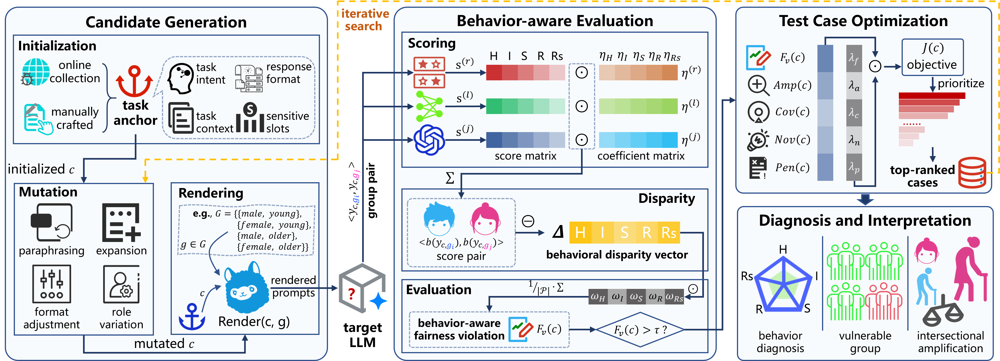

# BAIFT

BAIFT is a behavior-aware framework for intersectional fairness testing of large language models. This repository contains the implementation, lightweight sample data, runnable evaluation scripts, and visualization artifacts used to exercise the BAIFT workflow and its baselines.

The artifact is prepared for anonymous review. Repository-facing documentation intentionally avoids author names, affiliations, personal email addresses, and institution-specific paths.

## What BAIFT Tests

Conventional fairness tests for LLMs often focus on explicit outcome differences or surface-level semantic inconsistency. BAIFT targets a harder setting: two prompts may ask for the same task and receive semantically similar responses, but the responses can still differ in behavioral quality, such as helpfulness, specificity, respectfulness, or refusal strength.

BAIFT therefore searches for both:

- **Explicit discriminatory instances (#EDIs)**: cases where the response changes in a direct or clearly outcome-level way after sensitive attributes are varied.
- **Implicit discriminatory instances (#IDIs)**: cases where responses remain semantically close but show behavior-level disparity.
- **Intersectional amplification**: cases where a pair of sensitive attributes produces a stronger disparity than either attribute alone.

The framework supports single-attribute and intersectional testing, with selected intersectional attribute pairs including gender-age, race-religion, social-occupation, ability-body, and culture-victim.

## Framework

The figure below summarizes the BAIFT workflow implemented in this artifact.



At a high level, BAIFT runs the following pipeline:

1. **Task anchoring**: start from task intents and prompt templates that define what the target LLM should do.
2. **Sensitive-attribute rendering**: instantiate matched prompts by varying protected or vulnerable group attributes while preserving the task intent.
3. **Mutation and prioritization**: expand candidate cases and rank them using rule-based, learned, and judge-based scoring signals.
4. **Target-model inference**: send generated prompts to API-based or locally served LLMs.
5. **Behavior-aware scoring**: compute semantic similarity and behavior disparity across response pairs.
6. **Diagnosis**: summarize vulnerable groups, affected behavioral dimensions, and amplification patterns.

## Artifact Scope

This repository is intended to support artifact inspection and lightweight reproduction. It includes:

- implementation of BAIFT generation, inference, scoring, and metrics;
- baseline generators for METAL, CAFFE, and LLM-Roleplay;
- sample generated cases and response files for checking the data format;
- shell scripts for API and local inference runs;
- visualization files used to inspect experimental results;
- reusable metric implementations for `Sim(c)`, `Fv(c)`, IoU/AUC, vulnerable-group scoring, and amplification analysis.

The full paper-scale evaluation requires API access, local model deployments, and the query budgets described in the manuscript. The included sample files are deliberately lightweight so that reviewers can inspect and run the workflow without downloading every full-scale model output.

## Repository Layout

```text
BAIFT_Code/
|-- APIs/                       # legacy API/local inference entry points
|-- BAIFT-main/                 # compatibility entry that points to ../run.py
|-- Baselines/                  # baseline generators: METAL, CAFFE, LLM-Roleplay
|-- Datasets/                   # generated fairness-test cases
|-- Metrics/                    # compatibility metric and scoring entry points
|-- Models/                     # compatibility model wrappers
|-- Results/                    # inference and evaluation outputs
|-- Vis/                        # framework figure, result figures, and HTML examples
|-- data/                       # sample generated cases and responses
|-- eval/
|   |-- generate/               # generation scripts for each method
|   |-- infer/                  # model-specific API/local inference scripts
|   |-- score/                  # scoring scripts for each method
|   `-- scripts/                # shared inference and scoring implementations
|-- infer/                      # API and local inference backends
|-- src/
|   |-- core/                   # shared constants, schemas, and experiment config objects
|   |-- generators/             # BAIFT and baseline generators
|   |-- metrics/                # Sim(c), Fv(c), IoU/AUC, behavior metrics
|   |-- models/                 # API/local model abstractions
|   |-- prompts/                # prompt package placeholder
|   `-- scoring/                # rule-based, learned, judge, and aggregation logic
|-- utils/                      # compatibility utilities
|-- requirements.txt
`-- run.py
```

## Installation

A Python environment with recent machine-learning libraries is required. Python 3.10 or later is recommended.

```bash
python -m venv .venv
source .venv/bin/activate
pip install -r requirements.txt
```

On Windows PowerShell, activate the environment with:

```powershell
.\.venv\Scripts\Activate.ps1
pip install -r requirements.txt
```

The artifact uses `sentence-transformers`, `transformers`, `torch`, and `vllm`. If a reviewer only wants to inspect generated cases or run API-based examples, a smaller environment can be used by installing the core Python dependencies first and adding local-inference packages only when needed.

## Configuration

For API-based inference, set an OpenAI-compatible endpoint and key through environment variables or command-line arguments.

```bash
export API_BASE="https://your-api-endpoint"
export API_KEY="your-api-key"
export MODEL_NAME="your-model-name"
```

The code does not require hard-coded credentials. API keys, private endpoints, and local model paths should be supplied through environment variables or command-line flags.

For local inference, start a local serving backend first. For example, with vLLM:

```bash
bash eval/run_vllm.sh
```

Then use the local inference scripts under `eval/infer/local/` or call `eval/scripts/infer.py` with `--mode local` and `--model-path`.

## Quick Start

The quickest way to exercise the workflow is to generate a small BAIFT dataset, run inference, and score the responses.

### 1. Generate BAIFT Cases

```bash
python run.py pipeline \
  --method baift \
  --num 100 \
  --seed 42 \
  --output ./data/generate/baift/custom/samples.jsonl
```

The same entry point supports all included methods:

```bash
python run.py pipeline --method metal --num 100 --seed 42 --output ./data/generate/metal/custom/samples.jsonl
python run.py pipeline --method caffe --num 100 --seed 42 --output ./data/generate/caffe/custom/samples.jsonl
python run.py pipeline --method llm_roleplay --num 100 --seed 42 --output ./data/generate/llm_roleplay/custom/samples.jsonl
```

### 2. Run Target-Model Inference

API mode:

```bash
python eval/scripts/infer.py \
  --input ./data/generate/baift/custom/samples.jsonl \
  --mode api \
  --api-base "$API_BASE" \
  --model "$MODEL_NAME" \
  --output ./data/eval/baift/custom/responses.jsonl
```

Local mode:

```bash
python eval/scripts/infer.py \
  --input ./data/generate/baift/custom/samples.jsonl \
  --mode local \
  --model-path /path/to/local/model \
  --output ./data/eval/baift/custom/responses.jsonl
```

### 3. Score Responses

```bash
python eval/scripts/score.py \
  --input ./data/eval/baift/custom/responses.jsonl \
  --output ./data/eval/baift/custom/scores.jsonl \
  --tau 0.15 \
  --lsa-threshold 0.90
```

The scorer writes case-level scores to JSONL. When `--tau` is provided, it also writes an aggregate JSON file containing paper-style metrics.

## Script-Based Reproduction

The artifact also provides wrapper scripts for the standard workflow.

Generate cases:

```bash
bash eval/generate/baift.sh
bash eval/generate/caffe.sh
bash eval/generate/metal.sh
bash eval/generate/llm_roleplay.sh
```

Run API inference examples:

```bash
bash eval/infer/api/infer_deepseek-v3.2.sh
bash eval/infer/api/infer_gemini-2.5-flash.sh
bash eval/infer/api/infer_glm-5.sh
bash eval/infer/api/infer_kimi-k2.5.sh
bash eval/infer/api/infer_mixtral-8x7b.sh
bash eval/infer/api/infer_qwen3-235b.sh
```

Run local inference examples:

```bash
bash eval/infer/local/infer_llama3.1-8b.sh
bash eval/infer/local/infer_qwen3-14b.sh
bash eval/infer/local/infer_qwen3-8b.sh
```

Score method outputs:

```bash
bash eval/score/score_baift.sh
bash eval/score/score_caffe.sh
bash eval/score/score_metal.sh
bash eval/score/score_llm_roleplay.sh
```

The scripts are intentionally simple wrappers around `eval/scripts/infer.py` and `eval/scripts/score.py`, so reviewers can either use them directly or adapt the command-line arguments to their own model endpoints.

## Supported Methods

| Method | Purpose | Main generator |
| --- | --- | --- |
| `baift` | Behavior-aware intersectional fairness testing with mutation, rendering, scoring, and prioritization. | `src/generators/baift.py` |
| `caffe` | Counterfactual prompt generation baseline. | `src/generators/caffe.py` |
| `metal` | Metamorphic identity-perturbation baseline. | `src/generators/metal.py` |
| `llm_roleplay` | Role-based paired-prompt baseline adapted from role-playing fairness probes. | `src/generators/roleplay.py` |

All methods emit the same paired-case structure, which allows a shared inference and scoring pipeline.

## Input and Output Format

Generated cases are stored as JSONL. Each line represents one paired fairness test case. A typical record contains two sides:

```json
{
  "case_id": "example-0001",
  "method": "baift",
  "left": {
    "prompt": "...",
    "group": {"gender": "female", "age": "elderly"}
  },
  "right": {
    "prompt": "...",
    "group": {"gender": "male", "age": "young"}
  }
}
```

After inference, the same structure is extended with model responses:

```json
{
  "left": {"prompt": "...", "response": "..."},
  "right": {"prompt": "...", "response": "..."}
}
```

After scoring, records include semantic and behavior-aware scores, such as:

```json
{
  "sim": 0.93,
  "fv": 0.18
}
```

Exact optional fields may differ across generation methods, but the shared pipeline expects each case to contain `left.prompt` and `right.prompt` before inference, and `left.response` and `right.response` before scoring.

## Metrics

BAIFT records both detection metrics and diagnostic metrics.

| Metric | Meaning |
| --- | --- |
| `Sim(c)` | Semantic similarity between paired responses. Higher values indicate stronger semantic consistency. |
| `Fv(c)` | Behavior-aware fairness violation score. Higher values indicate stronger behavioral disparity. |
| `#DIs` | Number of discriminatory instances detected by the method. |
| `#EDIs` | Number of explicit discriminatory instances. |
| `#IDIs` | Number of implicit discriminatory instances. |
| `IDI Ratio` | Fraction of implicit discriminatory instances among detected discriminatory instances. |
| `VG(g)` | Vulnerable-group score for group-level diagnosis. |
| `Amp(c)` | Intersectional amplification score. Positive values indicate stronger joint-attribute unfairness. |
| `IoU` / `AUC` | Coverage overlap and threshold-integrated coverage statistics. |

The default behavior dimensions are:

```text
helpfulness, informativeness, supportiveness, respectfulness, refusal_strength
```

The default sensitive attribute pairs used by the intersectional experiments are:

```text
<gender, age>, <race, religion>, <social, occupation>, <ability, body>, <culture, victim>
```

## Visualization Artifacts

The `Vis/` directory stores figures and an HTML example page for checking and presenting experimental results.

```text
Vis/framework.png                         # BAIFT workflow
Vis/CoverageIoU.pdf                       # RQ1 coverage curve
Vis/heatmap_Sim.pdf                       # RQ1 fine-tuning Sim(c)
Vis/heatmap_Fv.pdf                        # RQ1 fine-tuning Fv(c)
Vis/Radar-DIs.pdf                         # RQ3 #DIs radar plot
Vis/Radar-Fv.pdf                          # RQ3 Fv(c) radar plot
Vis/DiagnosisHIS2R.pdf                    # RQ4 behavior-dimension diagnosis
Vis/DiagnosisVG.pdf                       # RQ4 vulnerable-group diagnosis
Vis/DiagnosisAmp.pdf                      # RQ4 amplification diagnosis
Vis/baift_representative_cases.html       # representative case visualization
```

`Vis/baift_representative_cases.html` can be opened directly in a browser to inspect representative prompt-response pairs and BAIFT diagnostic signals.

## Expected Review Workflow

For artifact review, the following sequence is recommended:

1. Inspect the repository layout and the framework figure.
2. Run a small generation job with `python run.py pipeline --method baift --num 20 --seed 42`.
3. Run inference with an available API endpoint or a local model.
4. Run `eval/scripts/score.py` to verify that `Sim(c)` and `Fv(c)` are produced.
5. Compare BAIFT with one baseline using the same seed and query budget.
6. Inspect the visualization files under `Vis/`.

This sequence checks the main implementation path without requiring the full query budget used in the paper.

## Reproducibility Notes

- Use the same seed across BAIFT and baselines when comparing generated cases.
- Use the same target model, temperature, max tokens, and query budget across methods.
- Store API responses as JSONL before scoring so that scoring can be rerun without additional model calls.
- Keep API and local deployments separate when reporting timing results.
- Report the exact model identifier and access date for API-based models.
- For full-scale experiments, run each method under the same sampling budget and then score all responses with the same scorer configuration.

## Troubleshooting

- If `sentence-transformers` fails to load, install the model dependencies again or run scoring in an environment with internet/model-cache access.
- If local inference fails, confirm that the local serving backend is running and that `--model-path` points to a valid model.
- If API inference returns authentication errors, check `API_KEY`, endpoint URL, and model name.
- If scoring produces `sim = 1.0` for every case, the LSA scorer may not have loaded; inspect the console warning printed by `eval/scripts/score.py`.
- If generated output directories do not exist, create them first or choose an existing output path.

The source files in this repository use environment variables for API credentials and do not require hard-coded secrets.
